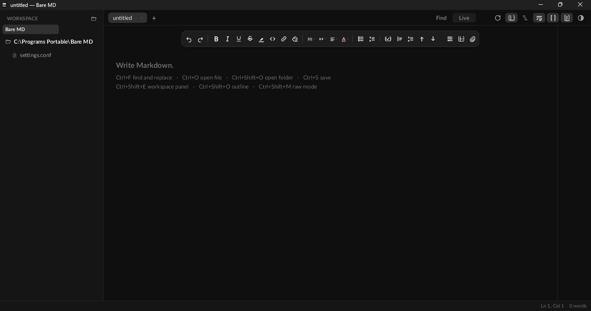

# Bare MD

  

A vibecoded portable Markdown editor. Why another one? I tried a few popular editors and didn't like their ui or how they were made. This project is mostly for my own use, but if someone likes it, great.

**Written in rust:**
winit + wgpu backend, text renderer written from scratch (shaping with `rustybuzz`, glyph rasterisation with `fontdue`, an R8 glyph atlas and a single instanced-quad pipeline). No WebView, no Electron, no Tauri, no UI toolkit.

**This editor is for you if you're looking for:**
* A simple notepad-like editor just for .md files
* Similar to the Obsidian experience
* Live editing, no split view
* Portability

**What it's not / not planned right now:**
* A complex professional editor
* No plugins support
* No shortcuts remap
* No localization

I wanted it to be mostly feature complete at release. I'll only add things if there's something genuinely important

## Building
Requirements: Rust **1.86+** and a working Vulkan/Metal/DX12/OpenGL driver.

`cargo run --release`

## Keyboard
|      |      |
| ---- | ------ |
| `Ctrl+N`, `Ctrl+T` / `Ctrl+W`        | new document / close tab                                                                                                                                         |
| `Ctrl+O` / `Ctrl+Shift+O`            | open file / open folder                                                                                                                                          |
| `Ctrl+S` / `Ctrl+Shift+S`            | save / save as                                                                                                                                                   |
| `Ctrl+Tab`                           | next tab                                                                                                                                                         |
| `Ctrl+F` / `Ctrl+H`                  | find / find + replace                                                                                                                                            |
| `Ctrl+Z` / `Ctrl+Y`, `Ctrl+Shift+Z`  | undo / redo                                                                                                                                                      |
| `Ctrl+B` / `Ctrl+I`                  | bold / italic                                                                                                                                                    |
| `Ctrl+E` / `Ctrl+K` / `Ctrl+Shift+X` | inline code / link / strikethrough                                                                                                                               |
| `Ctrl+U` / `Ctrl+Shift+H`            | underline / highlight                                                                                                                                            |
| `Ctrl+1` … `Ctrl+6`                  | heading 1–6 (same level again returns to a paragraph)                                                                                                            |
| `Ctrl+Shift+T`                       | document-tools menu                                                                                                                                              |
| Right-click                          | the document menu (clipboard, table commands, formatting) — only over the central panel; on a tab it closes that tab                                             |
| Middle-click                         | close the tab under the pointer; on the empty part of the tab strip it opens a new document; on a workspace chip it closes that workspace; anywhere else it pans |
| `Ctrl+Shift+M`                       | cycle the view mode: Live → Live+ → Raw                                                                                                                          |
| `Tab` / `Shift+Tab`                  | indent / outdent the whole line (marker included)                                                                                                                |
| `Enter` / `Shift+Enter`              | continue the block (quote, list) / end it                                                                                                                        |
| `Ctrl+Shift+E`                       | workspace panel                                                                                                                                                  |
| `Alt+M`                     | minimap                                                                                                                       |
|                                      `Alt+T`|                                                                                                                                                                  next theme (black → grey → white)|
| `Alt+↑` / `Alt+↓`                    | move the current line up / down                                                                                                                                  |
| `Ctrl+±` / `Ctrl+0`                  | zoom / reset zoom                                                                                                                                                |
